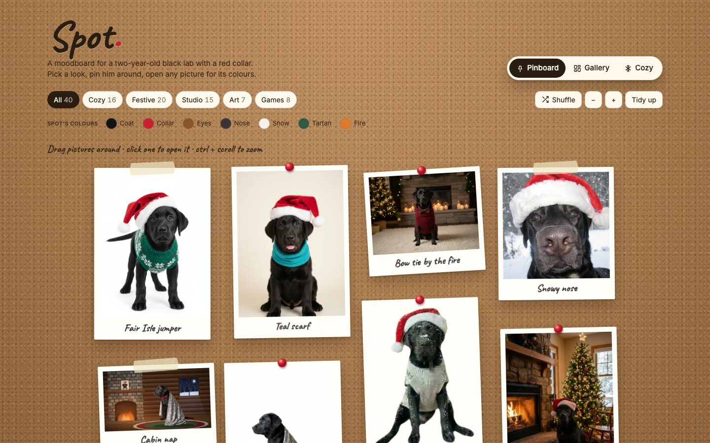
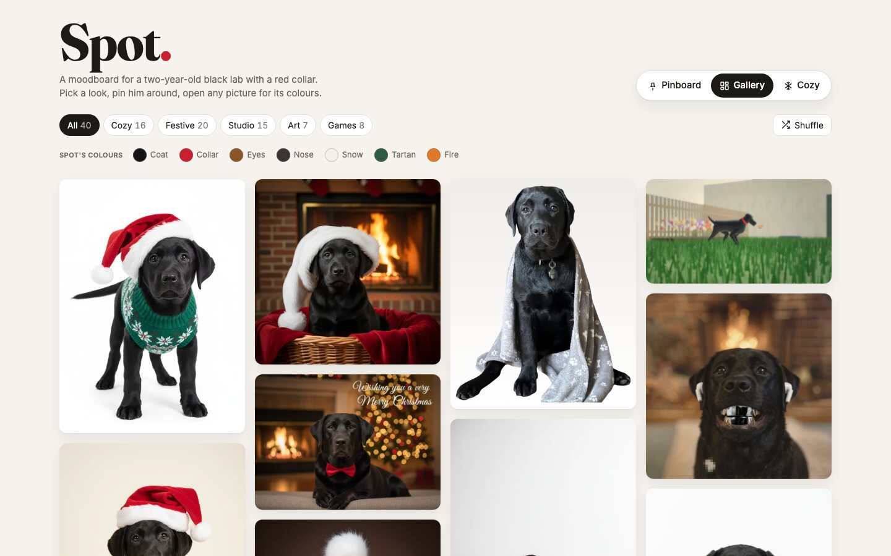
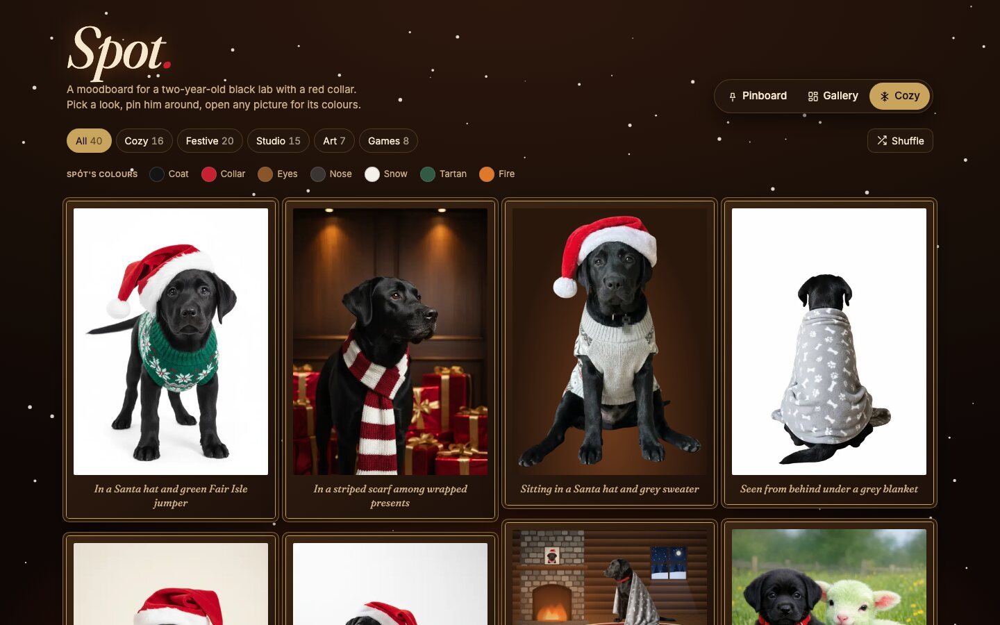
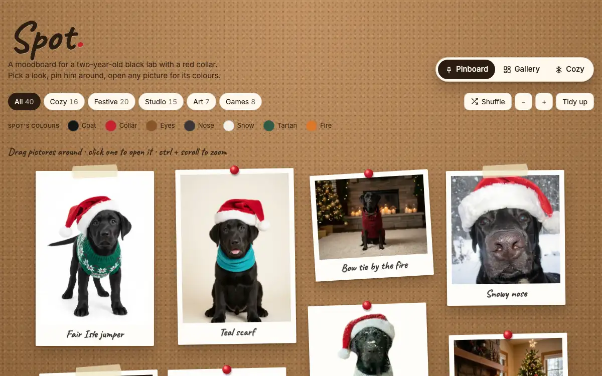
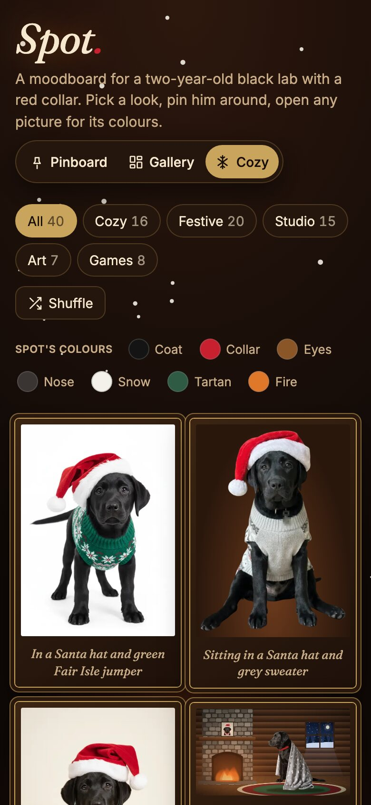

<div align="center">


# Spot moodboard

**An interactive moodboard for Spot, a black lab with a red collar. Pin him around a cork board, browse a clean gallery, or warm up by the fire.**

[Open it](#open-it) · [The three looks](#the-three-looks) · [What you can do](#what-you-can-do) · [Privacy](#privacy) · [Run it locally](#run-it-locally) · [Contributing](#contributing) · [Licence](#licence)

-blue)


[](https://github.com/Gitguy268/spot-moodboard/actions/workflows/test.yml)



</div>

Spot is a two-year-old black labrador with a red collar. This page collects 40 pictures of him: portraits in blankets and Christmas jumpers, a few illustrations, and screenshots from the games and the screensaver he stars in. Pick one of three looks, filter by mood, drag pictures around, and open any one to see and copy its colours.

<!-- live-links -->
**Live:** [gitguy268.github.io/spot-moodboard](https://gitguy268.github.io/spot-moodboard/) · [spot-moodboard.vercel.app](https://spot-moodboard.vercel.app)
<!-- /live-links -->

## Open it

Open the [live page](https://gitguy268.github.io/spot-moodboard/). It works on phones too. To keep a copy, download the repository and double-click `index.html`; it runs straight from your disk, no server needed.

## The three looks

| Pinboard | Gallery | Cozy |
|---|---|---|
|  |  |  |
| Polaroids with pins and tape on cork. Drag them anywhere. | A clean masonry grid that follows your light or dark setting. | Gold frames, fireplace glow and falling snow, festive pictures first. |

<div align="center">

</div>

## What you can do

| | |
|---|---|
| **Look** | Pinboard, Gallery or Cozy, in the top right. Your choice is remembered. |
| **Filter** | All, Cozy, Festive, Studio, Art, Games |
| **Move pictures** (pinboard) | drag with the mouse; on a phone, press and hold, then drag. Arrow keys nudge a focused picture. |
| **Zoom** (pinboard) | `−` and `+`, or ctrl + scroll (pinch on a trackpad) |
| **Tidy up** (pinboard) | lays the current filter's pictures out neatly again |
| **Shuffle** | a new order and a new board |
| **Open a picture** | click or tap it, or focus it and press Enter. `←` `→` or a swipe step through, Esc closes. |
| **Colours** | the viewer shows the five main colours of each picture; the strip under the title has Spot's own colours. Click any colour to copy its hex code. |

Positions on the pinboard are saved per filter in your browser (localStorage), so your arrangement is still there next time. Nothing is sent anywhere.



## Privacy

The pictures were picked so they identify nobody:

- no people, hands or faces; no addresses, phone numbers, QR codes or shop logos
- collar tags are pixelated wherever they show, so no engraving can be read
- every file was stripped of all metadata (EXIF, GPS, XMP, IPTC, C2PA) and renamed, so no camera, place, date or AI prompt travels with it

CI checks that no metadata creeps back in. If you spot something that should not be here, please use [private reporting](SECURITY.md).

<details>
<summary><b>How the pictures are prepared</b></summary>

`scripts/prepare-images.mjs` turns the source pictures into `assets/`:

1. reads the first frame, auto-orients, strips every profile and metadata block
2. pixelates the listed collar-tag regions (blocks of about 1/14 of the region)
3. trims the empty border of cut-out pictures
4. writes a 1600 px WebP for the viewer and a 640 px WebP thumbnail, with `cwebp -metadata none`
5. measures the five main colours with ImageMagick and writes `assets/data.js` (id, title, alt text, tags, size, colours)

The source pictures are not in this repository. Re-running the script needs them and ImageMagick 7 plus `cwebp`:

```sh
npm run images   # reads scripts/sources.local.json: { "<id>": "/path/to/source picture" }
```

</details>

<details>
<summary><b>How it works</b></summary>

- One `index.html` with inline CSS and JavaScript, no framework and no build step. `assets/data.js` is a plain script, not a JSON fetch, so the page also works from `file://`.
- **Pinboard:** cards are absolutely placed with `transform`. Each card drops into the shortest column with a little jitter and tilt from a seeded random generator. Positions are stored as a fraction of the board width, so they survive window resizes. Dragging uses pointer events. On touch, a 280 ms hold picks a card up and a non-passive `touchmove` stops the page from scrolling. A quick swipe still scrolls.
- **Gallery and Cozy:** CSS multi-column masonry. Cozy adds a canvas of falling snow and a flickering hearth glow.
- **Viewer:** a `<dialog>` with keyboard, swipe and colour-copy support.
- `prefers-reduced-motion` turns off the tilt, snow movement and flicker. `prefers-color-scheme` sets the gallery's light or dark theme.

</details>

## Run it locally

```sh
git clone https://github.com/Gitguy268/spot-moodboard.git
cd spot-moodboard
open index.html            # or double-click start.command for a local server on port 5213
```

Tests and pictures:

```sh
npm ci
npx playwright install chromium webkit
npm run smoke      # every look x filter, drag, viewer, saved positions, phone, file://
npm run capture    # regenerates the pictures in docs/ (needs img2webp from `brew install webp`)
```

**Deploy:** pushing to `main` publishes to GitHub Pages through `.github/workflows/pages.yml`. The Vercel copy is a static deploy of the same files.

## More Spot

[Spot-light HD](https://github.com/Gitguy268/spot-light-hd) (the laser-dot game) · [Spot-light](https://github.com/Gitguy268/spot-light) (the original) · [Spot screensaver](https://github.com/Gitguy268/spot-screensaver) · [spot-cli](https://github.com/Gitguy268/spot-cli) (Spot in your terminal)

## Contributing

Issues and pull requests are welcome. See [CONTRIBUTING.md](CONTRIBUTING.md) and the [code of conduct](CODE_OF_CONDUCT.md).

## Licence

The code is [MIT](LICENSE). The **pictures of Spot are not**: the author keeps all rights to them. Most portraits are AI-generated from photos of him. The fonts (Caveat, Fraunces, Inter) load from Google Fonts under the SIL Open Font License. See [NOTICE](NOTICE).
